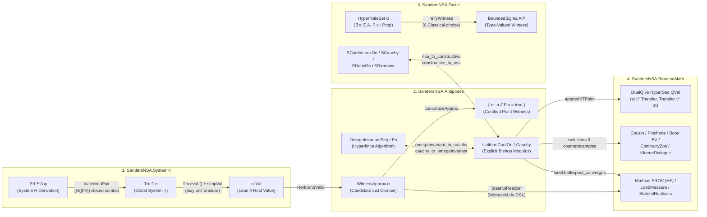
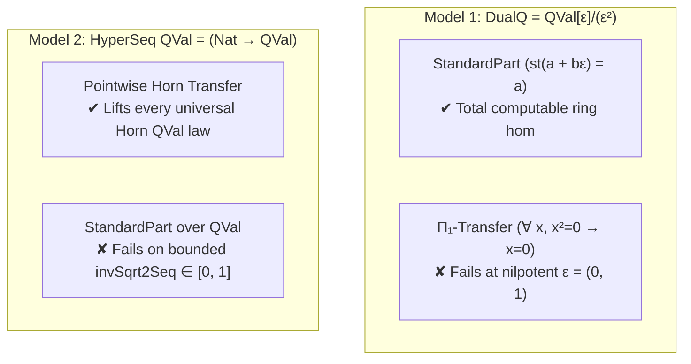

# Exhaustive Developer & Mathematical Reconstruction Guide (`sanders-computable-nsa`)

> **Purpose of this document**: A complete, self-contained manual teaching a Lean 4 developer how to reconstruct every module of `sanders-computable-nsa` **by hand from scratch**, together with the surrounding mathematical context (Proof Mining, Nonstandard Dialectica, Constructive Analysis, Higher-Order Reverse Mathematics) and the exact Lean 4 kernel/compiler engineering tradeoffs discovered along the way.

---

## Table of Contents

1. [The Big Picture: Why Nonstandard Analysis Has Direct Computational Content](#1-the-big-picture-why-nonstandard-analysis-has-direct-computational-content)
2. [Global Architectural Invariants & Kernel Purity Rules](#2-global-architectural-invariants--kernel-purity-rules)
3. [Part I — `SandersNSA.SystemH`: System $\mathcal{T}$, System $\mathcal{H}$ & Nonstandard Dialectica](#3-part-i--sandersnsasystemh-system-t-system-h--nonstandard-dialectica)
   - 3.1 [Intrinsically Well-Typed Syntax via `SnocList`, `Ren`, and `Sub`](#31-intrinsically-well-typed-syntax-via-snoclist-ren-and-sub)
   - 3.2 [Avoiding Exponential Term Blowup: Closed System $\mathcal{T}$ Combinators & `let`-Sharing](#32-avoiding-exponential-term-blowup-closed-system-t-combinators--let-sharing)
   - 3.3 [Eliminating `brecOn` Blowup: Single-Pass `dTypes`, `dialecticaPair` & Lazy Unit Erasure](#33-eliminating-brecon-blowup-single-pass-dtypes-dialecticapair--lazy-unit-erasure)
   - 3.4 [Machine-Checked Semantics (`eval_wk`, `eval_substPar`, `eval_beta`) & Herbrand Refinement](#34-machine-checked-semantics-eval_wk-eval_substpar-eval_beta--herbrand-refinement)
4. [Part II — `SandersNSA.Antipodes`: Exact Rationals, Abstract Interpretation, Overspill & IVT/Dini](#4-part-ii--sandersnsaantipodes-exact-rationals-abstract-interpretation-overspill--ivtdini)
   - 4.1 [Subtraction-Free Exact Rationals (`QVal`) & Avoiding `Classical.choice` in `omega`](#41-subtraction-free-exact-rationals-qval--avoiding-classicalchoice-in-omega)
   - 4.2 [Nonstandardization as Abstract Interpretation (`WitnessApprox` Galois Connection)](#42-nonstandardization-as-abstract-interpretation-witnessapprox-galois-connection)
   - 4.3 [Overspill, Underspill & Sanders's $\Omega$-Invariance Principle](#43-overspill-underspill--sanderss-omega-invariance-principle)
   - 4.4 [Hyperfinite IVT, the `LLPO` Hovering Obstruction, and Computable Dini's Theorem](#44-hyperfinite-ivt-the-llpo-hovering-obstruction-and-computable-dinis-theorem)
5. [Part III — `SandersNSA.Tactic`: Set/Type Reification & Bidirectional Elaboration](#5-part-iii--sandersnsatactic-settype-reification--bidirectional-elaboration)
   - 5.1 [Defeating `Prop` Erasure: `HyperfiniteSet` and `BoundedSigma` Witness Reification](#51-defeating-prop-erasure-hyperfiniteset-and-boundedsigma-witness-reification)
   - 5.2 [Writing `nsa_to_constructive`, `constructive_to_nsa` & `#nsa_translate` in `TacticM`](#52-writing-nsa_to_constructive-constructive_to_nsa--nsa_translate-in-tacticm)
6. [Part IV — `SandersNSA.ReverseMath`: Countermodels, HORM, Dialogue Trees, `PROV`, Loeb & Stateful Realizers](#6-part-iv--sandersnsareversemath-countermodels-horm-dialogue-trees-prov-loeb--stateful-realizers)
   - 6.1 [Mutual Independence of `st` and `Transfer` (`DualQ` vs. `HyperSeq QVal`)](#61-mutual-independence-of-st-and-transfer-dualq-vs-hyperseq-qval)
   - 6.2 [Cousin's Lemma, Pincherle's Theorem & Non-Uniform Gauge Blowup](#62-cousins-lemma-pincherles-theorem--non-uniform-gauge-blowup)
   - 6.3 [Borel's Height Countability & Branchless Jordan Bounded Variation (`BV`)](#63-borels-height-countability--branchless-jordan-bounded-variation-bv)
   - 6.4 [Waaldijk–Sanders Generalized Continuity Zoo & Separating Counterexamples](#64-waaldijksanders-generalized-continuity-zoo--separating-counterexamples)
   - 6.5 [Kleene S1–S9 Dialogue Trees: Baire Trace Continuity vs. Cantor Fan Modulus](#65-kleene-s1s9-dialogue-trees-baire-trace-continuity-vs-cantor-fan-modulus)
   - 6.6 [Mathias's Provident Set Theory (`PROV`) via Fuel-Invariant Structural `HF`](#66-mathiass-provident-set-theory-prov-via-fuel-invariant-structural-hf)
   - 6.7 [Hyperfinite Counting Measure, Loeb Squeeze & the Riemann Expectation Identity](#67-hyperfinite-counting-measure-loeb-squeeze--the-riemann-expectation-identity)
   - 6.8 [Dinis–Miquey Imperative/Stateful Realizers (`LawfulMonad` + `MonotoneStore`)](#68-dinismiquey-imperativestateful-realizers-lawfulmonad--monotonestore)
7. [Part V — Kernel Axiom Auditing (`Lean.collectAxioms`) & Step-by-Step Build Order](#7-part-v--kernel-axiom-auditing-leancollectaxioms--step-by-step-build-order)

---

## 1. The Big Picture: Why Nonstandard Analysis Has Direct Computational Content

A widespread myth in foundations of mathematics holds that Abraham Robinson's Nonstandard Analysis (NSA) is inherently *non-constructive* because model-theoretic constructions of ${}^*\mathbb{R}$ invoke a free ultrafilter $\mathcal{U}$ on $\mathbb{N}$ (requiring forms of the Boolean Prime Ideal Theorem / Hahn–Banach).

Work over the last fifteen years by **Benno van den Berg, Eyvind Briseid, Pavol Safarik** (*APAL* 2012), **Sam Sanders** (*Reuniting the Antipodes*, *Synthese* 2020; *To be or not to be constructive*, *Indag. Math.* 2018), **Dag Normann & Sam Sanders** (Higher-Order Reverse Mathematics, 2018–2025), and **Chuangjie Xu** (`nonstandard_dialectica`, 2024–2026) overturned that view:

1. **Syntactic Conservativity without Ultrafilters**: Edward Nelson's *Internal Set Theory* (`IST`), restricted to finite types (`System H`), axiomatizes the unary predicate $\mathrm{st}(x)$ ("$x$ is standard") via **Idealisation (`I`)**, **Standardisation / Choice (`HAC`)**, and **Transfer (`T`)** — without ever constructing an ultrafilter.
2. **Finite Candidate Lists Replace Exact Witnesses**: Under Gödel's Dialectica interpretation adapted to `System H` ($D_{\mathrm{st}}$), an external existential $\exists^{\mathrm{st}} x\,\Phi(x)$ is realized **not** by a single point $x$, but by a **finite list of candidate witnesses** $[x_1, \dots, x_k]$ guaranteed to contain at least one valid witness (a *Herbrand disjunction*).
3. **Nonstandardization as Abstract Interpretation**: As Chuangjie Xu observed in correspondence (Jan 2026), passing from a constructive proof to a nonstandard proof acts like a **sound abstract interpreter**:
   - A constructive proof of $\forall n\,\exists k \le n\,\dots$ tracks a singleton witness $[0]$ (`r3 n = [0]`).
   - A nonstandard proof invoking bounded standardness ($m \le n \land \mathrm{st}(n) \Rightarrow \mathrm{st}(m)$, `lmStLe`) *widens* the witness to the finite countdown range $[n, n-1, \dots, 0]$ (`r3'' n = [n, …, 0]`).
   - When the matrix $P(n, k)$ is decidable ($\Delta_{\mathrm{int}}$), linear scan (`concretizeApprox` / `extractExactWitness`) refines that widened candidate list back into a single certified constructive witness!
4. **$\varepsilon$–$\delta$ Moduli = Sequential Halo Schedules**: An elementary nonstandard definition such as
   $$\forall x, y \in {}^*[a, b],\ (x \approx y \implies {}^*f(x) \approx {}^*f(y))$$
   when interpreted sequentially over hypersequences $x, y : \mathbb{N} \to \mathbb{Q}$ with explicit modulus witnesses (`InfinitelyClose`) carries **the exact same computational data** as Errett Bishop's `UniformContOn` modulus $\omega : \mathbb{N} \to \mathbb{N}$.

### System Architecture Wiring Diagram



---

## 2. Global Architectural Invariants & Kernel Purity Rules

Every file in `SandersNSA/` obeys six strict engineering invariants enforced by `lakefile.toml` (`autoImplicit = false`, `--wfail`) and `SandersNSA/AxiomAudit.lean`:

| Invariant | What NOT to do | What we do instead |
|---|---|---|
| **1. Zero `noncomputable`** | Never use `Real`, `Finset.toList`, `Classical.choose`, or `Exists.choose` | Use `QVal`, `HyperfiniteSet` (`List α`), and `Type`-valued moduli |
| **2. Zero `Classical.choice`** | Never run `omega` directly on an `Iff` goal (`P ↔ Q`) or `by_cases` on undecidable `Prop` | Split `↔` with `constructor` first, or use `Int.not_lt` / decidable `Bool` |
| **3. Zero `sorry` / `axiom`** | Never postulate transfer, overspill, or fan continuity | Prove constructive realizations over explicit trees, sequences, and grids |
| **4. Structural Termination** | Avoid `partial def` and nested `WellFounded.fix` where kernel reduction stalls | Use parallel renamings/substitutions (`Ren`/`Sub`) and depth-fuel (`HF.extEqFuel`) |
| **5. `Type` vs. `Prop` Separation** | Never hide a modulus $\omega$ inside `∃ ω : Nat → Nat, … : Prop` | Package moduli as fields of `Type`-valued `structure`s; carry laws as `Prop` fields |
| **6. Zero External Dependencies** | Avoid Mathlib import overhead (~2 GB cache) | Build on pure `leanprover/lean4:v4.35.0` stdlib (compiles cold in ~15 seconds) |

> **Subtle Lean 4 Pitfall Discovered During Axiom Auditing**:
> In Lean 4.35, calling `omega` directly on an `Iff` goal such as `¬ a < b ↔ b ≤ a` or `m = 0 ↔ m ≤ 0` closes the goal via `Classical.byContradiction`, silently injecting `Classical.choice` into the theorem's kernel axiom footprint! Splitting `↔` into two implications (`constructor`) or using `Int.not_lt` / `Nat.eq_zero_of_le_zero` eliminates `Classical.choice` completely.

---

## 3. Part I — `SandersNSA.SystemH`: System $\mathcal{T}$, System $\mathcal{H}$ & Nonstandard Dialectica

### 3.1 Intrinsically Well-Typed Syntax via `SnocList`, `Ren`, and `Sub`

To port Chuangjie Xu's Agda `nonstandard_dialectica` into Lean 4 **without** Agda's `{-# TERMINATING #-}` pragma:

1. **Right-Growing Contexts (`SnocList α`, `Syntax.lean`)**:
   ```lean
   inductive SnocList (α : Type) : Type where
     | nil  : SnocList α
     | snoc : SnocList α → α → SnocList α
   ```
   De Bruijn indices `Mem x xs : Type` (`hd` and `tl`) are `Type`-valued positions, not `Prop` proofs, because `Tm.eval` branches on them at runtime to look up values in environment tuples `Env Γ`.

2. **Why Single-Variable Substitution Fails Structural Termination (and How Parallel `Ren`/`Sub` Fixes It)**:
   If you try to write single-variable substitution `subst0 : Tm (Γ.snoc σ) τ → Tm Γ σ → Tm Γ τ` directly, pushing under `.lam` requires weakening the substituted term `u : Tm Γ σ` to `Tm (Γ.snoc ρ) σ`. Now your recursive call receives a *newly constructed* term `wk u`, which is no longer structurally smaller if you later need to compose substitutions!

   Instead, follow the **Two-Pass Parallel Renaming/Substitution Pattern**:
   - **Pass 1 (`Ren Γ Δ := ∀ {τ}, Mem τ Γ → Mem τ Δ`)**:
     - `Ren.lift r : Ren (Γ.snoc σ) (Δ.snoc σ)` maps `.hd ↦ .hd` and `.tl i ↦ .tl (r i)`.
     - `Tm.wk (r : Ren Γ Δ) (t : Tm Γ τ) : Tm Δ τ` recurses **purely structurally on `t`**!
   - **Pass 2 (`Sub Γ Δ := ∀ {τ}, Mem τ Γ → Tm Δ τ`)**:
     - `Sub.lift s : Sub (Γ.snoc σ) (Δ.snoc σ)` maps `.hd ↦ .var .hd` and `.tl i ↦ (s i).wk Ren.wkn`.
     - `Tm.substPar (s : Sub Γ Δ) (t : Tm Γ τ) : Tm Δ τ` ALSO recurses **purely structurally on `t`**!
   - Single substitution `t.subst0 u` is then a 1-line wrapper instantiating `.hd ↦ u` and `.tl i ↦ .var i`.


### 3.2 Avoiding Exponential Term Blowup: Closed System $\mathcal{T}$ Combinators & `let`-Sharing

**Critical Performance Lesson**: When compiling extracted System $\mathcal{T}$ terms (`ex1`, `ex3''`, `ex4Hac`) to native C in Lean 4, a naive port of textbook Dialectica rules will **hang at startup**! Why? Three compounding blowups occur if you aren't careful:

1. **Re-weakening Open Smart Constructors**:
   If `mapTm (f : Tm Γ (σ ⇒ τ)) (xs : Tm Γ (.list σ))` builds an inline `.listRec` that calls `f.wk .wkn2` inside the step branch, then nesting `k` list combinators copies and traverses the entire AST of `f` $k$ times!
   - **Fix**: Define **closed (`Cxt := .nil`) System $\mathcal{T}$ combinators** once at top level (`appendComb`, `mapComb`, `appListComb`, `collect1Comb`, `collect2Comb`, `pairRightComb`, `pairListComb`, `pairNegComb`, `pr2NegComb`, `appendNegComb`). Applying `mapTm f xs` simply weakens a tiny 6-node constant (`mapComb.wk .empty`) in $O(1)$ and applies it to `f` and `xs` without touching `f` or `xs`!

2. **Exponential Duplication in `appendNeg` and `.impElim` / `.orElim`**:
   - In `appendNeg Ξ c₁ c₂` (used to merge counterexample tuples across contexts `Ξ` of length 7+), matching on `Ξ` and duplicating `c₁` and `c₂` into `.pr1` and `.pr2` branches creates $2^{|\Xi|}$ copies of `c₁` and `c₂`! Wrapping `c₁` and `c₂` in a closed combinator `appendNegComb Ξ` reduces size from $O(2^{|\Xi|} \cdot (|c_1| + |c_2|))$ to $O(|\Xi| + |c_1| + |c_2|)$!
   - In `.orElim`, `dp.1` and `dq.1` each appear 3 times (`orElim` has depth 2 in `lmStLe`, turning 3x into $6^2 = 36\times$, and then `.allIntro`'s `subst0` unshares every pointer in strict C!).
   - **Fix**: Bind subproof realisers once via System $\mathcal{T}$ $\beta$-redex `let`-sharing:
     ```lean
     Tm.app (.lam bodyUsingVarHdMultipleTimes) dp.1
     ```
     Now `dp.1` appears **once** in the AST, keeping `dialecticaPair p` strictly $O(|p|)$ in size!

### 3.3 Eliminating `brecOn` Blowup: Single-Pass `dTypes`, `dialecticaPair` & Lazy Unit Erasure

1. **Single-Pass Mutual Tuples**:
   In Lean 4, writing mutual structural functions `dPos φ` and `dNeg φ` over `Fml` compiles via `Fml.brecOn`, which packs **both** branches at every constructor. Writing `def dTypes : Fml → Ty × Ty` explicitly as a single structural pass and projecting `dPos φ := (dTypes φ).1`, `dNeg φ := (dTypes φ).2` avoids `brecOn` overhead completely (same for `dialecticaPair` and `simpBackPair`).

2. **Lazy Unit Erasure (`simpArrVal`, `simpProdLazy`, `simpListMap`)**:
   Internal formulas `φ` (`isInternal φ = true`) have trivial witness and counterexample types (`dPos φ` and `dNeg φ` simplify to `.unit`). If `simpArrVal` on `σ ⇒ .unit` evaluates `fun x => simpVal .unit (f (backVal σ x))`, strict evaluation in Lean 4 **still calls `f (...)`** just to discard its result and return `()`! Inside `ex1` / `ex3''`, dead counterexample branches contain nested recursors over dummy witnesses.
   - **Fix**: Pattern-match on `τ.simp` **before** building the closure:
     ```lean
     | .unit => fun _ => ()
     ```
     Combined with closed combinators, this dropped the full `sanders-nsa-tests` binary runtime from >60s timeout to **1.04 seconds**!

### 3.4 Machine-Checked Semantics (`eval_wk`, `eval_substPar`, `eval_beta`) & Herbrand Refinement

To prove metatheoretic soundness of term evaluation:
1. Prove `eval_wk (r : Ren Γ Δ) (t : Tm Γ τ) (env : Env Δ) : t.wk r |>.eval env = t.eval (fun i => env (r i))` by structural induction on `t` (using `funext` on `.lam`).
2. Prove `eval_substPar (s : Sub Γ Δ) (t : Tm Γ τ) (env : Env Δ) : t.substPar s |>.eval env = t.eval (fun i => (s i).eval env)` by structural induction on `t`, invoking `eval_wk` on `Sub.lift`.
3. Specialize to `eval_beta : ((.lam body).app arg).eval env = (body.subst0 arg).eval env`.
4. For **Herbrand Witness Refinement (`extractExactWitness`)**: given `F : α → List β` satisfying `HerbrandValid P F` (`∀ x, ∃ y ∈ F x, P x y = true`), walk `F x` with dependent `if hPy : P x y = true` (`findValidInList`) to produce a certified single point `{ y : β // P x y = true }` with zero classical choice!

---

## 4. Part II — `SandersNSA.Antipodes`: Exact Rationals, Abstract Interpretation, Overspill & IVT/Dini

### 4.1 Subtraction-Free Exact Rationals (`QVal`) & Avoiding `Classical.choice` in `omega`

Why build `QVal` (`ConstructiveAnalysis.lean`) instead of importing `Rat`?
- Every denominator is encoded as `denPos : Nat` representing **`denPos + 1 ≥ 1`**, so positivity of denominators (`denInt_pos : 0 < p.denInt`) is unconditional and division-by-zero branches never pollute arithmetic lemmas!
- Cross-multiplied relations `QVal.eqv p q := p.num * q.denInt = q.num * p.denInt` and `QVal.le p q := p.num * q.denInt ≤ q.num * p.denInt` reduce directly to linear/ring goals over `Int`.
- Use **unit-fraction precision scales** `QVal.unitFrac k := 1 / (k + 1)` throughout constructive analysis:
  - Every `unitFrac k` is strictly positive for *every* `k : Nat` (including `k = 0`, which is `1`!).
  - Halving tolerance uses the clean index map `k ↦ 2 * k + 1`, verified by `unitFrac_half_sum`:
    $$\frac{1}{(2k+1)+1} + \frac{1}{(2k+1)+1} = \frac{2}{2(k+1)} \approx \frac{1}{k+1}.$$

### 4.2 Nonstandardization as Abstract Interpretation (`WitnessApprox` Galois Connection)

In `AbstractInterpretation.lean`, we model Chuangjie Xu's insight directly as an abstract domain:
- Concrete witness: `x : α` satisfying `P x = true`.
- Abstract state: `WitnessApprox α` (`candidates : List α`), ordered by `Subsumes u v := ∀ x ∈ u.candidates, x ∈ v.candidates`.
- **Galois Adjunction (`galois_singleton_subsumes`)**:
  $$\mathrm{Subsumes}(\mathrm{embedExact}(x), u) \iff x \in u.\mathrm{candidates}.$$
- **Interpretation of System $\mathcal{H}$ Rules as Abstract Domain Operations**:
  - Constructive witness introduction $\mapsto$ `embedExact x` (`[x]`)
  - Disjunction elimination (`orElim`) $\mapsto$ `joinApprox u v` (`u ++ v`)
  - Implication / `HAC` composition (`collect1Comb`) $\mapsto$ `bindApprox u k` (`flatMap`)
  - Bounded standardness (`lmStLe`: $m \le n \land \mathrm{st}(n) \Rightarrow \mathrm{st}(m)$) $\mapsto$ `boundApprox B` (`[B, B-1, …, 0]`)
  - Decidable matrix refinement $\mapsto$ `concretizeApprox P u hSound : { x : α // x ∈ u.candidates ∧ P x = true }`.

### 4.3 Overspill, Underspill & Sanders's $\Omega$-Invariance Principle

In `OverspillOmega.lean`:
1. **Constructive Overspill (`overspillPrecisionIndex`)**:
   Classically, if an internal relation $R(k, N)$ holds at every standard $k \in \mathbb{N}$ when $N$ is nonstandard, overspill yields a nonstandard $\tilde{k} \le N$ with $\forall j \le \tilde{k},\ R(j, N)$. Computably, given any decidable `R : Nat → Nat → Bool` and standard schedule `mod : Nat → Nat` (`∀ k, ∀ N ≥ mod k, R k N = true`), scanning upward for the largest prefix `{0, …, K}` holding at grid `N` produces an explicit growing schedule `K(N)` certified both **valid** (`∀ j ≤ K(N), R j N = true`) and **divergent** (`N ≥ mod M ⇒ M ≤ K(N)`).
2. **Constructive Underspill (`underspillMinThreshold`)**:
   Finds the exact least `n ≤ N` where `P n = true`, proving minimality (`∀ j < n_min, P j = false`).
3. **Sanders's $\Omega$-Invariance (`omegaInvariant_to_cauchy`, `omegaInvariantFn_to_uniformCont`)**:
   A hyperfinite algorithm `G : Nat → QVal` whose output varies by at most `1 / (k + 1)` across resolutions `M, N ≥ mod k` *is literally* a `CauchySeqWithModulus`! Similarly, a resolution-uniform family `F : Nat → QVal → QVal` that is locally non-expansive at scale `mod k` induces a standard `UniformContOn` modulus cleanly via the 3-hop triangle inequality:
   $$|f(x) - f(y)| \le |f(x) - F_N(x)| + |F_N(x) - F_N(y)| + |F_N(y) - f(y)|.$$

### 4.4 Hyperfinite IVT, the `LLPO` Hovering Obstruction, and Computable Dini's Theorem

In `IVTAndDini.lean`:
- **Why Approximate IVT Is Constructive (`findGridCrossing`, `approxIVT_spec`)**:
  On a hyperfinite grid $0, \frac{1}{N+1}, \dots, 1$ with $f(0) \le 0 \le f(1)$, decidable rational sign comparison (`QVal.leB (f x_i) 0`) **must** flip at some adjacent pair $(x_i, x_{i+1})$ separated by $\frac{1}{N+1}$. Choosing $N = \omega_f(k)$ immediately forces $|f(x_i)| \le \frac{1}{k+1}$!
- **Why Exact IVT Fails Without Local Non-Constancy (`hoveringTent`, `llpo_hovering_jump`)**:
  For $f_c(x)$ flat near $0$ with small perturbation $c$, the grid crossing jumps macroscopically between $x = 1/4$ and $x = 3/4$ depending on the sign of $c$ — formalizing Bishop's `LLPO` obstruction. Adding `SeparationModulus` restores `exactIVT_cauchy`!
- **Computable Dini's Theorem (`extractDiniModulus`, `dini_uniform_conv`)**:
  Instead of extracting a finite subcover non-constructively via Heine–Borel, we cover $[0, 1]$ by $G + 1$ grid points at fineness $G = \omega_{\mathrm{equi}}(2k + 1)$ and take the finite maximum $\max_{0 \le i \le G} \omega_{\mathrm{pw}}(x_i, 2k + 1)$!

---

## 5. Part III — `SandersNSA.Tactic`: Set/Type Reification & Bidirectional Elaboration

### 5.1 Defeating `Prop` Erasure: `HyperfiniteSet` and `BoundedSigma` Witness Reification

In Lean 4, writing `∃ x ∈ s, P x` lands in `Prop`: Lean's code generator erases the witness `x`, so extracting `x` into `Type` via `Classical.choose` marks your function `noncomputable`!

In `SetTypeBridge.lean`, we solve this cleanly:
- Represent internal / hyperfinite sets as `HyperfiniteSet α` backed by `elements : List α`.
- Whenever `P : α → Prop` has `[DecidablePred P]`, **reify** `h : ∃ x, x ∈ₕ A ∧ P x` (`Prop`!) into `BoundedSigma A P` (`Type`!) by recursively testing `P a` on the concrete list `A.elements` and only using `h` in the impossible `[]` base case (`False.elim`) to discharge exhaustiveness!
- Result: **zero `Classical.choice`**, **100% kernel-computable**, and directly composable into dependent choice graphs (`reifyHyperfiniteChoice`, `reifyChoiceGraph`).

### 5.2 Writing `nsa_to_constructive`, `constructive_to_nsa` & `#nsa_translate` in `TacticM`

In `Translate.lean`:
1. Maintain a verified metadata table `nsaTranslationTable : List DualEntry` pairing each sequential NSA structure (`SContinuousOn`, `SCauchy`, `SLimit`, `SDerivOn`, `SRiemannIntegrable`) with its Bishop constructive dual (`UniformContOn`, `CauchySeqWithModulus`, `LimitWithModulus`, `DiffOnWithModulus`, `RiemannIntegrableWithModulus`), its `Type`-valued conversion functions in both directions, and its `Nonempty` equivalence theorem.
2. In `TacticM`:
   - Call `getMainTarget >>= instantiateMVars`.
   - Inspect whether the goal is wrapped in `Nonempty (...)` (in which case rewrite via `rw [nonemptyIff]`) or is a direct `Type`-valued realiser goal (in which case `apply constructiveToNsaFn` or `apply nsaToConstructiveFn` via `evalTactic`).
   - For hypothesis translation (`nsa_to_constructive_at h`), inspect `(← hDecl.type)` and replace `h` in place via `replace h := fn h`.

---

## 6. Part IV — `SandersNSA.ReverseMath`: Countermodels, HORM, Dialogue Trees, `PROV`, Loeb & Stateful Realizers

### 6.1 Mutual Independence of `st` and `Transfer` (`DualQ` vs. `HyperSeq QVal`)

In `Independence.lean`, we construct two **100% computable algebraic models** over `QVal`:



- **Key Proof Trick in Model 2 (`sq_diff_le_for_unit_and_any_q`)**:
  To prove no $q \in \mathbb{Q}$ (positive, zero, or negative!) can be infinitely close to `invSqrt2Seq`, avoid messy sign case-splits on $q$ by proving the universal inequality valid for all $s \in [0, 1]$ and **all** $q \in \mathbb{Q}$:
  $$|s^2 - q^2| = |s - q| \cdot |s + q| \le (1 + |q_{\mathrm{num}}|) \cdot |s - q|.$$
  Combined with constructive infinite-descent irrationality `no_qval_sq_eqv_half` ($q^2 \not\approx 1/2$, hence $|q^2 - 1/2| > \frac{1}{K+1}$ for an explicit $K$), any putative `InfinitelyClose invSqrt2Seq (starConst q)` yields an immediate contradiction!

### 6.2 Cousin's Lemma, Pincherle's Theorem & Non-Uniform Gauge Blowup

In `CousinPincherle.lean`:
- **Uniform Cousin (`solveUniformCousin`)** vs. **Adaptive Dyadic Cousin (`solveDyadicCousin`)**: uniform moduli allow direct $O(k)$ grid partitioning, while pointwise gauges bisect recursively around `QVal.midpoint`.
- **Non-Uniform Gauge Obstruction (`puncturedDenomGauge`)**: assigning gauge scale `x.den` (`1 / (q.den + 1)`) to each rational $x \in [0, 1]$ defines a strictly positive neighbourhood around every rational, yet takes arbitrarily large fineness requirement $K + 1$ at $x = \frac{1}{K+1} \in [0, 1]$ (`nonuniform_gauge_unbounded`), illustrating why uncountable Cousin (`HBU`) leaps to full second-order arithmetic in Normann–Sanders HORM!

### 6.3 Borel's Height Countability & Branchless Jordan Bounded Variation (`BV`)

In `BorelBV.lean` (after Normann & Sanders, `arXiv:2208.03027`):
- **Borel's Height Definition of Countability (`HeightCountable`)**: instead of asking for a global enumeration `Nat → α` or injection `α → Nat`, Borel asks for a height function `height : α → Nat` whose sublevel sets `{ x ∈ S | height x ≤ H }` are explicitly listed (`sublevel : Nat → List α`).
- **Jordan Decomposition (`jordan_decomposition`)**: decompose each step $f(n+1) - f(n)$ into `posStep` and `negStep` using `QVal.leB`. Rather than expanding 5-fraction common denominators by hand, prove `qval_add_comm`, `qval_add_assoc`, `qval_neg_add`, and `qval_add_four_swap` once — then both `f(0) + P(n) - N(n) ≈ f(n)` and `P(n) + N(n) ≈ TV(n)` become clean 6-line algebraic chains!
- **Borel Jump Bound (`borel_jump_height_bound`)**: each step of size $\ge \frac{1}{k+1}$ contributes at least $\frac{1}{k+1}$ to `totalVariation`, so `TV(n) ≤ V` forces `countLargeJumps f k n ≤ (k + 1) * V` — giving an automatic Borel height function on discontinuity jumps of any `BV` function!

### 6.4 Waaldijk–Sanders Generalized Continuity Zoo & Separating Counterexamples

In `ContinuityZoo.lean` (`arXiv:2303.00493`):
- **How to Make Quasi-Continuity & Cliquishness Computable**:
  Classically, Kempisty quasi-continuity says: *"for every $x$, $r > 0$, $\varepsilon > 0$, there exists a non-empty open $(a, b) \subseteq B(x, r)$ on which $|f(z) - f(x)| < \varepsilon$"*. We reify that existential into a `Type`-valued box selector `selectBox : QVal → Nat → Nat → OpenBox` returning a certified non-degenerate interval `lo < hi`!
- **Clean Separating Counterexamples**:
  - `heavisideHalf` ($0$ on $(-\infty, 1/2]$, $1$ on $(1/2, \infty)$): refutes `UniformContOn` at $x = \frac{1}{2}, y = \frac{1}{2} + \frac{1}{2(\omega(1)+1)}$.
  - `isolatedSpike` ($1$ at $x \approx 1/2$, $0$ elsewhere):
    - **Not `QuasiContOn`**: any box `[lo, hi]` with `lo < hi` around `1/2` has at least one endpoint (`lo` or `hi`) not equal to `1/2`, where $|0 - 1| = 1 > 1/2$!
    - **Is `CliquishOn`**: `cliquish_isolatedSpike` shifts the selected box slightly off `1/2` ($[x + \frac{1}{4r+4}, x + \frac{1}{2r+2}]$ for $x \ge 1/2$, symmetric on the left for $x < 1/2$), so `isolatedSpike` is identically $0$ across the entire box and pairwise oscillation is $0$!

### 6.5 Kleene S1–S9 Dialogue Trees: Baire Trace Continuity vs. Cantor Fan Modulus

In `KleeneDialogue.lean` (`arXiv:2102.04787`):
- Represent sequential S1–S9 oracle computations over `f : Nat → α` via `Dialogue α β` (`.answer b` | `.query idx k`).
- Kleene's substitution scheme **S4** is `Dialogue.bind`, certified by `eval_bind`.
- **Why Cantor Has a Uniform Modulus While Baire Only Has a Pointwise Modulus**:
  - On `Nat → α` (Baire space), `pointwiseModulus d f` follows the *single path* taken on `f`, proving pointwise continuity (`eval_eq_of_agree_below_pointwiseModulus`). Yet `adaptiveLookupDialogue` (`f ↦ f(f(0) + 1)`) proves **no** uniform bound exists on `Nat → Nat` (`adaptive_not_uniform`).
  - On `Nat → Bool` (Cantor space), every `.query idx k` has **only two branches** (`k false` and `k true`), so `fanModulus` recursively visits *all* leaves of the finite tree and computes a uniform modulus (`eval_eq_of_agree_below_fanModulus`) constructively without Weak König's Lemma or Cohen forcing!

### 6.6 Mathias's Provident Set Theory (`PROV`) via Fuel-Invariant Structural `HF`

**Engineering Gem in `Provident.lean`**:
If you define hereditarily finite sets as `inductive HF | mk : List HF → HF`, naive mutual recursion for extensional equality `extEqB (.mk xs) (.mk ys)` calls `extEqB x y` inside `List.all` / `List.any` over *two* nested lists simultaneously, causing painful mutual well-foundedness obligations in proofs.

**The Structural-Fuel Trick**:
1. Define `depth : HF → Nat` (`1 + max child depth`) via simple `mutual` recursion with `depthList`. Every element `x ∈ xs` strictly decreases depth: `x.depth < (HF.mk xs).depth`.
2. Define `extEqFuel : Nat → HF → HF → Bool` by **purely structural recursion on `fuel : Nat`**!
3. Prove **Fuel Invariance (`extEqFuel_invariant`)**: for any `k₁, k₂ ≥ max a.depth b.depth`, `extEqFuel k₁ a b = extEqFuel k₂ a b`.
4. Set `extEqB a b := extEqFuel (Nat.max a.depth b.depth) a b`.
   - Need to unfold `extEqB (.mk xs) (.mk ys)`? `extEqB_mk` gives the exact un-fueled equation!
   - Need transitivity on *three* sets `a, b, c`? Switch all three to common fuel `K := a.depth + b.depth + c.depth` via `extEqB_eq_fuel` and induct on `K` in 8 lines!
5. Build Mathias's **powerset-free Cartesian product**:
   ```lean
   def cartesian (a b : HF) : HF :=
     sUnion (repl a (fun x => repl b (fun y => kpair x y)))
   ```
   Certified by `memB_cartesian_iff` using only Replacement and Union — zero Powerset!

### 6.7 Hyperfinite Counting Measure, Loeb Squeeze & the Riemann Expectation Identity

In `LoebMeasure.lean`:
- Representing `hyperfiniteProb N P` directly as `⟨(hyperfiniteCount P (N + 1) : Int), N⟩` fixes the denominator to `N + 1`, making `0 ≤ μ_N(P) ≤ 1`, disjoint additivity (`hyperfiniteProb_disjoint_or`), and complementation (`hyperfiniteProb_complement`) immediate consequences of integer arithmetic + `hyperfiniteCount_inclusion_exclusion`.
- Defining `hyperfiniteExpect N g := QVal.unitFrac N * hyperfiniteSum g (N + 1)` makes `hyperfiniteExpect N (fun i => f (QVal.gridPt N i)) = uniformGridSum f N` hold **by syntactic equality (`=`)**, bridging Loeb grid integration directly to `RiemannIntegrableWithModulus`!

### 6.8 Dinis–Miquey Imperative/Stateful Realizers (`LawfulMonad` + `MonotoneStore`)

In `StatefulRealizers.lean` (`arXiv:2210.05346`):
- `StatefulRealizer σ α` (`run : σ → α × σ`) implements `Monad` and `LawfulMonad` (all 9 monad laws proved in 9 lines by `cases ...; rfl`!), unlocking Lean 4 `do`-notation.
- Setting `σ := WitnessApprox τ` gives `WitnessM τ α`. Instead of proving full Hoare triples for every line of a `do`-block, prove the lightweight **`MonotoneStore`** invariant (`Subsumes s (m.run s).2`): once *any* step emits a valid witness or countdown bound (`emitCountdown_sound`), every subsequent store-monotone step automatically preserves `SoundApprox P` (`seq_sound_of_monotone`), and `runAndConcretize` extracts a certified `{ w : τ // P w = true }` at the end!

---

## 7. Part V — Kernel Axiom Auditing (`Lean.collectAxioms`) & Step-by-Step Build Order

### How `#audit_pure_constructive` Works (`SandersNSA/AxiomAudit.lean`)

Instead of eyeballing `#print axioms` output manually, write a compile-time `CommandElabM` macro:
```lean
elab "#audit_pure_constructive " ids:ident+ : command => do
  let env ← getEnv
  for idStx in ids do
    let declName ← liftCoreM <| realizeGlobalConstNoOverload idStx
    if Lean.isNoncomputable env declName then
      throwErrorAt idStx m!"[AxiomAudit] {declName} is marked noncomputable!"
    let axs ← liftCoreM <| Lean.collectAxioms declName
    for ax in axs do
      if ax == ``sorryAx || ax == ``Classical.choice || !permittedAxioms.contains ax then
        throwErrorAt idStx m!"[AxiomAudit] {declName} depends on forbidden axiom {ax}!"
```
Importing `SandersNSA.AxiomAudit` into root `SandersNSA.lean` guarantees that `lake --wfail build` fails immediately if any future edit accidentally introduces `sorry`, `noncomputable`, or `Classical.choice` anywhere in the transitive dependency graph!

### Recommended Order to Code This Library From Scratch Yourself

1. **`SandersNSA/Antipodes/ConstructiveAnalysis.lean`**: Build `QVal`, cross-multiplied `eqv`/`le`/`lt`, `dist_triangle`, `unitFrac_half_sum`, `gridPt`, and the 7 `Type`-valued modulus structures (`UniformContOn`, `CauchySeqWithModulus`, etc.).
2. **`SandersNSA/SystemH/Syntax.lean` → `Dialectica.lean` → `Examples.lean`**: Build `SnocList`, `Ty`, `Ren`, `Sub`, `Tm` (with closed list combinators!), `Fml`, `Prf`, `dialecticaPair` (with `.lam` sharing!), lazy `simpVal`, and `extractExactWitness`. Run `sr1 7` and `r3'' 5` via `#eval` to watch nonstandard countdown widening happen live!
3. **`SandersNSA/Antipodes/AbstractInterpretation.lean` → `OverspillOmega.lean` → `IVTAndDini.lean`**: Formalize `WitnessApprox`, `overspillPrecisionIndex`, `omegaInvariant_to_cauchy`, `findGridCrossing`, `llpo_hovering_jump`, and `extractDiniModulus`.
4. **`SandersNSA/Tactic/SetTypeBridge.lean` → `Translate.lean`**: Implement `HyperfiniteSet.reifyWitness` and the `TacticM` translators `nsa_to_constructive` / `constructive_to_nsa`.
5. **`SandersNSA/ReverseMath/*`**: Layer the 8 reverse-mathematics & foundational modules (`Independence`, `CousinPincherle`, `BorelBV`, `ContinuityZoo`, `KleeneDialogue`, `Provident`, `LoebMeasure`, `StatefulRealizers`).
6. **`SandersNSA/AxiomAudit.lean`, `Tests/Main.lean`, `Main.lean`**: Wire up `#audit_pure_constructive`, regression `assert!` tests, and the live CLI showcase.
